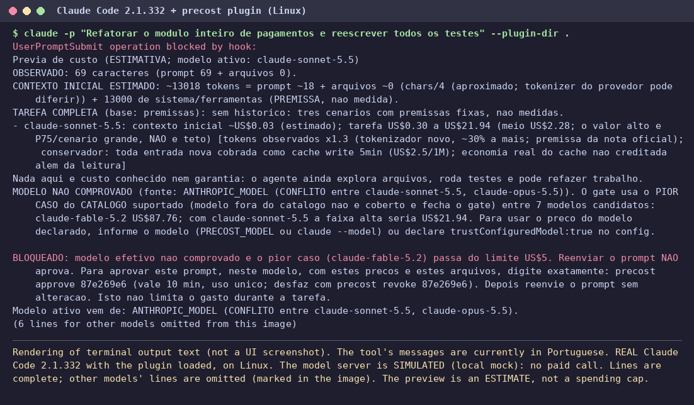
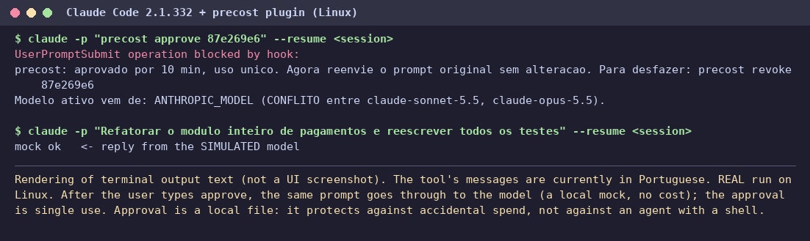
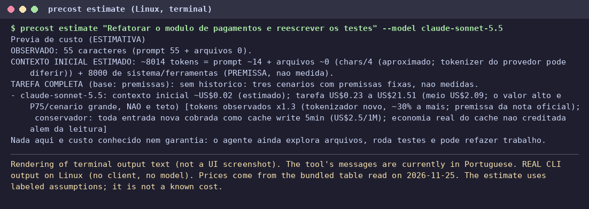
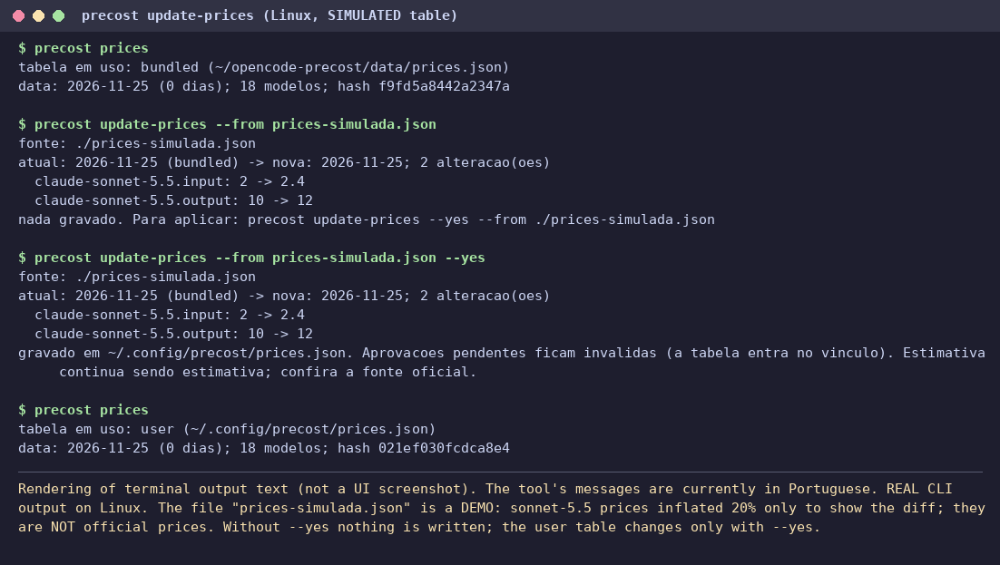
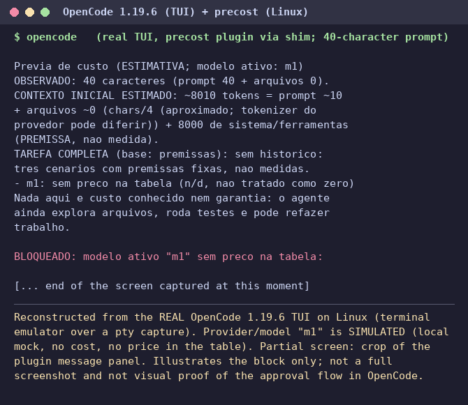

# opencode-precost

**English** | [Português (Brasil)](README.pt-BR.md)

Shows an **estimated** cost range *before* a task runs in a coding agent (OpenCode and Claude Code). Optionally asks for explicit approval when the high end of the range goes above a limit you set. No paid calls, no network access at run time.

> Status: development version 0.3.0 (private repository, nothing published yet). Read "Limits" before relying on it. Messages printed by the tool (CLI, hook, plugin) are currently in Portuguese; see "Language" below.

## What it does

- `precost estimate <task>` prints a per-model range (three fixed scenarios, or percentiles from your own session history). The high end is a P75 / large scenario, **not a cap**.
- A gate runs before your prompt reaches the model. With `limitUsd` set, a prompt whose high estimate is above the limit is blocked until you type `precost approve CODE`. The approval is bound to the prompt, model, session, price table, limit and estimated ceiling. It lasts 10 minutes (default) and works once.
- Fails closed when a limit is set: unreadable config, unknown model, model without a price, unreadable context file, or an internal error all block instead of letting the prompt through. Without `limitUsd` the tool only informs ("NO GATE").

## Pictures

All images are **renderings of terminal output text, not UI screenshots**. Where a model appears it is a **simulated** local server (no cost, no credentials). Everything shown was run on **Linux**; nothing here is macOS or Windows validation (see "Platforms").







Image 05 illustrates the block (a model with no price in the table) as a partial crop rebuilt from the real TUI. It is not a full screenshot and not proof of the approval flow in OpenCode.

## Install

Details, prerequisites and the validation matrix: [docs/INSTALLATION.md](docs/INSTALLATION.md).

- **Claude Code (plugin):** `claude --plugin-dir /path/to/opencode-precost` to try it locally. Marketplace install (`/plugin marketplace add <repo>`, `/plugin install precost`) will work only after the repository is public. Not published to any marketplace yet.
- **Claude Code (manual):** copy `adapters/claude-code/settings.example.json` into your Claude settings and fix the path. Keep `"onFailure": "block"`: without it a crashing, missing or hanging hook lets the prompt reach the model.
- **OpenCode (1.19.6 only):** `npm i opencode-precost @opencode-ai/plugin@1.19.6` (the package is not on npm yet; use `npm pack` from a clone) and create `.opencode/plugins/precost.js`:
  ```js
  import { PrecostPlugin } from 'opencode-precost';
  export const P = async (input) => PrecostPlugin(input, { limitUsd: 5 });
  ```
  Loading the plugin only through `opencode.json` was not verified.
- **Config** (`~/.config/precost/config.json`, Windows `%APPDATA%\precost\config.json`): `{"model":"claude-sonnet-5.5","limitUsd":5}`.
- **Check the install:** `node bin/precost.js doctor`. It cannot prove the client loaded the hook in your session. In a real session type `precost last` first: if a model answers, the hook is not loaded.

## Commands

Typed in the prompt (they never reach the model): `precost estimate <task>`, `precost last`, `precost approve CODE`, `precost revoke CODE|all`.
In a terminal: `node bin/precost.js estimate "task" --model claude-sonnet-5.5`.

### Update the reference price table

```
precost prices                                   # table in use, date, age (warns after 30 days)
precost update-prices --from FILE_OR_URL         # validates and shows the diff; nothing is written (URL must be https)
precost update-prices --from FILE_OR_URL --yes   # writes ~/.config/precost/prices.json (Windows: %APPDATA%\precost\prices.json)
precost update-prices                            # no --from and no PRECOST_PRICES_SOURCE: error with guidance, nothing changes
precost update-prices --reset                    # back to the bundled table
```

It rejects an invalid table, one older than the current one, or one with a removal or a change above 5x (use `--force` only after checking the source). It runs only from the CLI, never inside the hook or plugin. A user table is used only if it is not older than the bundled one. Changing the table invalidates pending approvals. There is **no default URL and no automatic reading of official pricing pages**: you provide the source (file or https URL). Today the bundled `data/prices.json` is the reference; the official pages cited per model remain the source of truth. Always check them.

## Platforms

What was actually executed is in the matrix in [docs/INSTALLATION.md](docs/INSTALLATION.md#validation-matrix). Linux is not validation of macOS or Windows. The code uses per-platform paths (`src/paths.js`) and the Claude Code hook uses `node` + `args` (no shell). `npm run e2e:native` (Node, no bash) runs the real clients against fake local servers on Linux, macOS and Windows; results per system are in the matrix. Official client support on Windows: Claude Code runs natively on Windows 10 1809+ (Git for Windows recommended); OpenCode runs on Windows but its docs recommend WSL.

## Test it

```
npm ci            # installs the dev dependency @opencode-ai/plugin@1.19.6 (needed by the OpenCode adapter test)
npm test          # 63 unit tests
npm run e2e:native            # real Claude Code 2.1.332 and OpenCode 1.19.6 vs fake servers: block, approve, single use, fail closed
npm run e2e:claude-plugin     # Claude Code plugin cycle (bash, Linux/macOS)
npm run e2e:claude-plugin-failure   # hook crash / missing node / timeout never reach the model (bash)
npm run e2e:opencode          # OpenCode 1.19.6 block/approve/single-use cycle (bash)
```
End-to-end scripts download pinned client versions through `npx` and call only local fake servers. No paid model is called.

## Limits

- It is an estimate: tokens are chars/4 (x1.3 for observed Claude 4.7+ tokens) plus an assumed system prompt (8k OpenCode, 13k Claude Code). It is not a known cost.
- The high end is not a cap. The gate acts before the prompt; it does not limit spend during a task or inside long loops.
- Claude Code does not tell the hook which model is active (observed in 2.1.332). An unproven model uses the worst case in the supported catalog, labeled as such.
- OpenCode has no automatic preview before the model; this plugin computes it inside `chat.message`. Blocking by throwing is undocumented behavior, so the plugin is pinned to OpenCode 1.19.6 and fails closed on other versions (unless `allowUnverifiedVersion` is set).
- Approval is a local file of the same user. It protects against accidental spend, not against an agent with a shell.
- The gate only works while the plugin or hook is loaded.
- Prices: Gemini from cloud.google.com/vertex-ai/generative-ai/pricing and Claude from platform.claude.com/docs/en/about-claude/pricing, read on 2026-11-25. Not modeled: batch, priority, fast mode, data residency. Carbon/Argon raw price is inferred.
- Token semantics were checked against real events and transcripts from OpenCode and Claude Code with **fake** providers. No comparison with a real invoice has been done.

More detail: [docs/CAPABILITIES.md](docs/CAPABILITIES.md).

## Language

The documentation is available in English (main) and Portuguese (Brasil). The messages printed by the tool itself are still Portuguese only; an English default with a language setting is proposed but not implemented.

## License

MIT. See [LICENSE](LICENSE). Copyright (c) 2026 Glauber Portella.
